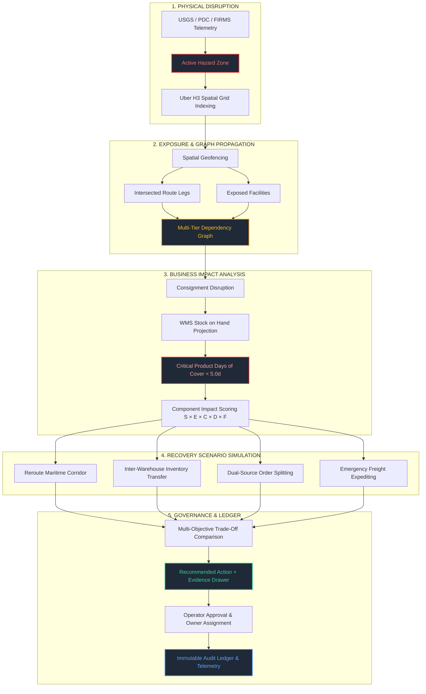
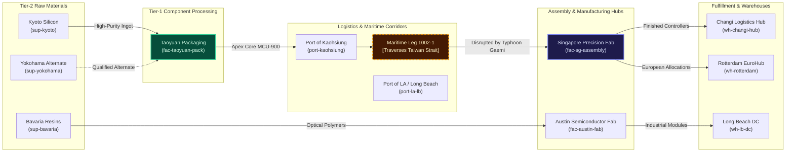

<div align="center">

# Research Analysis Directorate (RAD)
### Supply Chain Resilience Command Center

**An explainable, multi-tier supply chain digital twin and decision-support command center built on the RAD 3D geospatial intelligence console.**

[](LICENSE)
[](package.json)
[](https://cesium.com/)
[](https://h3geo.org/)
[](https://ref.gs1.org/standards/epcis/)
[](package.json)
[](src/supplyChain/)

[Explore Architecture](docs/SUPPLY_CHAIN_ARCHITECTURE.md) • [Data Dictionary](docs/SUPPLY_CHAIN_DATA_DICTIONARY.md) • [Demo Script](docs/SUPPLY_CHAIN_DEMO_SCRIPT.md) • [Localhost Setup](docs/RUN_LOCALLY.md)

</div>

---

## 🎯 Executive Overview

The **RAD Supply Chain Resilience Command Center** bridges real-world disruptions visible on the 3D globe directly into evidence-backed operational decisions.

Instead of treating disruptions as static map markers or generating ungrounded AI predictions, RAD models the complete multi-tier commercial graph—tracing physical hazards through exposed logistics corridors down to assembly bill-of-materials, stockout days of cover, and trade-off-optimized recovery actions.

$$\text{Hazard Trigger} \longrightarrow \text{Exposed Corridors \& Nodes} \longrightarrow \text{Inventory Stockout Projection} \longrightarrow \text{Multi-Objective Recovery Simulation} \longrightarrow \text{Approved Action} \longrightarrow \text{Immutable Audit Ledger}$$



---

## 🏛️ Epistemic Truth & Classification System

RAD enforces strict epistemic honesty across all views, data attributes, and calculated scores:

| Badge | Epistemic Status | Definition | Example in RAD |
|---|---|---|---|
| <kbd>OBSERVED</kbd> | Direct Fact | Ground-truth measurement from sensors, physical telemetry, or authoritative ERP/WMS reads. | Facility GPS coordinates, WMS cycle counts, active hazard coordinates. |
| <kbd>INFERRED</kbd> | Derived Reality | Deterministic mathematical derivation based strictly on observed data. | H3 hazard cell coverage, route corridor intersection, projected stockout date. |
| <kbd>SIMULATED</kbd> | Counterfactual | Outcome generated by the heuristic or optimization scenario engine. | Alternate bypass transit time, air charter surcharge, avoided stockout days. |
| <kbd>UNKNOWN</kbd> | Visibly Unobserved | Data that has not been reported; strictly preserved without hallucination. | Supplier Scope 3 emissions (displayed as `"Not Available"`), unlinked vessel IDs. |
| <kbd>STALE</kbd> | Expired TTL | Fact whose observation timestamp exceeds the valid operational window. | AIS telemetry older than provider update frequency. |

> [!IMPORTANT]
> **No Synthetic Certainty**: When commercial data is missing, RAD lowers the calculation's `dataConfidence` score rather than inventing commercial certainty.

---

## 🧩 Multi-Tier Supply Chain Twin Graph



---

## 🔬 Core Engine Architecture

### 1. Transparent Component Impact Scoring
RAD rejects opaque AI scores in favor of an explainable, 5-factor mathematical model:

$$\text{Impact} = S \times E \times C \times D \times F$$

- **Hazard Severity ($S \in [0, 1]$)**: Energy release, wind velocity, seismic magnitude, or dwell delay.
- **Asset Exposure ($E \in [0, 1]$)**: Spatial proximity, corridor containment, and H3 cell intersection.
- **Business Criticality ($C \in [0, 1]$)**: Asset tier, product category priority, and BOM centrality.
- **Recovery Difficulty ($D \in [0, 1]$)**: Alternate supplier availability, carrier lead times, and route elasticity.
- **Data Confidence ($F \in [0, 1]$)**: Epistemic integrity, sensor freshness, and completeness of commercial data.

### 2. Multi-Objective Recovery Solver
Every evaluated recovery alternative outputs rigorous multi-dimensional trade-offs:
- **Delay Delta ($\Delta t$)**: Projected schedule variance compared to unmitigated disruption.
- **Cost Impact ($\Delta \$ USD$)**: Fuel surcharges, expedited charter costs, or expedited handling fees.
- **Days Protected ($\Delta \text{DoC}$)**: Inventory coverage saved before assembly line stockout.
- **Capacity Utilization**: Feasibility confirmation against warehouse throughput and transport weight limits.
- **Carbon Footprint ($\text{tCO}_2\text{e}$)**: Energy emissions estimate, or explicitly `"Not Available"` when Scope 3 energy telemetry is unmetered.

### 3. GS1 EPCIS 2.0 Native Traceability
Internal events map directly to GS1 EPCIS 2.0 JSON-LD schema:
- **WHAT**: `urn:epc:id:sgtin:0614141.100200.shp-1002`
- **WHEN**: ISO 8601 UTC timestamp and timezone offset.
- **WHERE**: `geo:23.50,119.50` read point and SGLN physical business location.
- **WHY**: CBV business step (`transporting`, `receiving`, `holding`) and disposition (`in_transit`, `delayed`).
- **HOW**: Real-time sensor reports (wind velocity, temperature excursions).
- **PROVENANCE**: Source system, ingest timestamp, confidence score, and access classification.

---

## 🗺️ Geospatial Environment & Layer Infrastructure

Twenty layers and map sources. **Eighteen have a keyless path.**

- **Sits on the real ground.** Entity heights are aligned to work with Google 3D tiles, so aircraft park on aprons and cameras stand on street corners instead of floating.
- **Live Environmental Hazard Integration**: Integrated real-time hazard layers including NOAA/ECMWF cyclonic tracks, USGS earthquake telemetry, and NASA FIRMS active wildfire hotspots.
- **Global Context Feeds**: Live AIS maritime vessel positions and ADS-B flight vectors provide situational awareness around shipping corridors.
- **Uber H3 Spatial Grid**: Multi-resolution hexagonal discrete global grid indexing for real-time hazard aggregation and asset geofencing.
- DISPLAY ▸ **Draw** annotations, boundary markers, and measurement tools allow operators to mark corridors directly on the Cesium ellipsoid without exporting external geometry.

---

## 🚀 Quickstart & Localhost Execution

### 1-Click Launchers

#### Windows (File Explorer)
Double-click **`start-server.bat`**:
- Automatically checks for Node.js.
- Installs dependencies if `node_modules` is missing.
- Initializes `.env` with keyless defaults.
- Starts the server and opens your browser at `http://localhost:5173`.

#### Windows PowerShell
```powershell
.\start-server.ps1
```

#### macOS / Linux / WSL
```bash
chmod +x start-server.sh
./start-server.sh
```

### Standard npm Terminal Commands
```bash
# 1. Clone the repository
git clone https://github.com/SATTWIK-DEBNATH/HACKFEST.git
cd HACKFEST

# 2. Install dependencies (including h3-js and Cesium)
npm install

# 3. Launch the development server
npm start
# Server opens at http://localhost:5173
```

> [!TIP]
> **Keyboard Shortcut**: Press **`Alt+R`** anywhere in the browser to instantly open the **Resilience Command Center** panel.

---

## 🧪 Verification & Test Suite

The repository includes 27 comprehensive, pure unit tests validating mathematical calculations, graph traversal, and schema constraints:

```bash
# Run supply chain resilience test battery
node --test src/supplyChain/*.test.mjs
```

| Test Suite | Coverage | Status |
|---|---|---|
| `geofencing.test.mjs` | Haversine distance, H3 discrete cell indexing, spatial lookup | **PASS** (6/6) |
| `routeExposure.test.mjs` | Line segment distance, route intersection with hazard radius | **PASS** (3/3) |
| `dependencyPropagation.test.mjs` | Multi-hop graph traversal, critical stockout verification ($<5.0\text{d}$) | **PASS** (3/3) |
| `missingDataConfidence.test.mjs` | `UNKNOWN` value preservation, confidence penalty verification | **PASS** (3/3) |
| `scenarioFeasibility.test.mjs` | 4 recovery archetypes, carbon "Not Available" fallback | **PASS** (2/2) |
| `actionLedger.test.mjs` | State transitions, owner assignment, immutable audit trail | **PASS** (3/3) |
| `dataValidation.test.mjs` | CSV/JSON schema validation, non-silent rejection of invalid rows | **PASS** (4/4) |
| `epcis.test.mjs` | GS1 EPCIS 2.0 JSON-LD normalization, mock query adapter | **PASS** (3/3) |

```bash
# Verify architectural package boundaries
npm run check:boundaries

# Run production build
npm run build
```

---

## 🔌 Enterprise Integration Specifications

| Integration | Protocol / Pattern | Implementation Status | Purpose |
|---|---|---|---|
| **GS1 EPCIS 2.0** | JSON-LD / REST | Local Mock Adapter (`epcis.js`) | Standardized shipment and facility event traceability |
| **Apache Kafka** | Pub/Sub Streaming | In-Memory Streaming Broker (`kafka.js`) | Real-time event streaming for shipment GPS and alerts |
| **Apache Camel** | Enterprise Integration Patterns | EIP Route Transformer (`camel.js`) | EDI 315 / SAP IDoc to EPCIS message translation |
| **Eclipse Dataspace (EDC)** | Sovereign Data Sharing | Contract Policy Evaluator (`edc.js`) | Access-classified partner data governance |
| **OpenTelemetry** | W3C Distributed Tracing | Trace & Metric Spans (`telemetry.js`) | Ingestion latency and solver performance observability |
| **Process Mining (PM4Py)** | IEEE XES Event Log | Out-of-Process Adapter (`pm4py.js`) | Cycle-time analysis (Isolated to protect MIT vs AGPL-3.0) |
| **OpenLMIS** | Humanitarian Logistics | Cold-Chain Requisition (`openlmis.js`) | Vaccine excursion management and humanitarian relief |

---

## 📖 Documentation Index

- 📘 [Supply Chain Architecture Specification](docs/SUPPLY_CHAIN_ARCHITECTURE.md) — Comprehensive architecture, mathematical scoring derivations, H3 specs, and Google OR-Tools adapter boundaries.
- 📗 [Supply Chain Data Dictionary](docs/SUPPLY_CHAIN_DATA_DICTIONARY.md) — Detailed schema definitions for all domain entities, types, nullability rules, and EPCIS schemas.
- 📙 [Operator Demo Walkthrough Script](docs/SUPPLY_CHAIN_DEMO_SCRIPT.md) — Step-by-step guide executing all 9 evaluation acceptance criteria.
- 📕 [Localhost Setup & Operations Guide](docs/RUN_LOCALLY.md) — Multi-environment setup (1-click launchers, custom ports, production previews, and Docker).

---

## ⚖️ License & Attribution

- **Application Code**: Released under the [MIT License](LICENSE).
- **Licensing Isolation**: The Process Mining adapter (`pm4py.js`) is intentionally architected across a clean network service boundary to preserve the MIT license against AGPL-3.0 copyleft obligations.
- **Geospatial & Tile Providers**: Bundled datasets, OpenStreetMap, USGS, and Cesium ion carry their respective open data terms.
