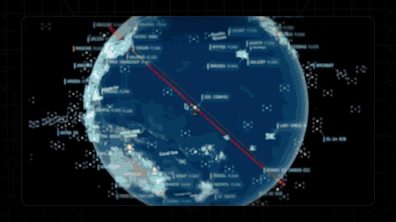
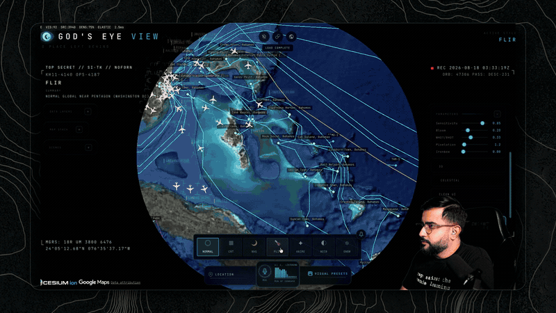
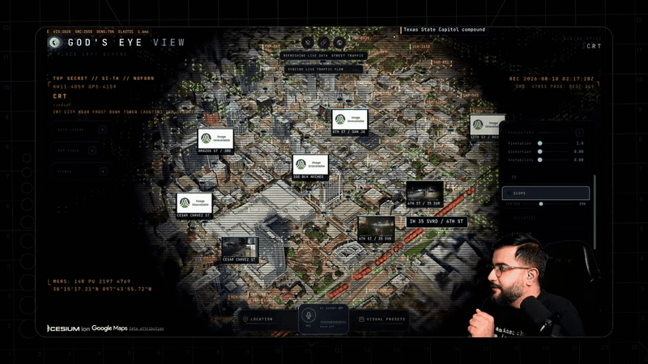
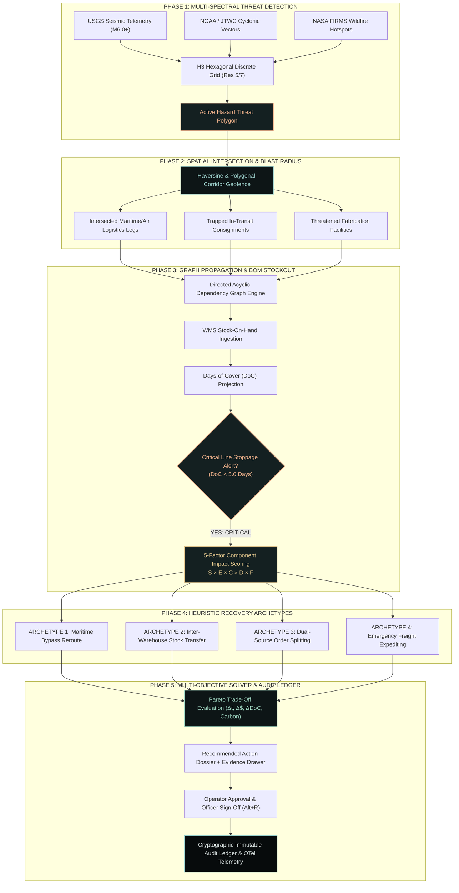
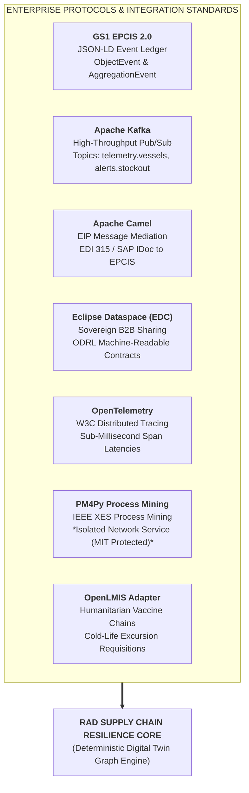

<!--
================================================================================
  RESEARCH ANALYSIS DIRECTORATE (RAD) // GEOSPATIAL INTELLIGENCE DIVISION
  SECURITY NOTICE: RESTRICTED DISTRIBUTION // DIRECTORATE EYES ONLY
  CLASSIFICATION: TOP SECRET // SCI // GEOINT-CYBER // NOFORN // ORCON
  PROJECT CODENAME: GOD'S EYE VIEW // OPERATION: RESILIENCE LENS
  DOCUMENT IDENTIFIER: RAD-DOC-GEOINT-2026-X88 // SYSTEM REVISION 4.5.0
================================================================================
-->

<div align="center">

```
======================================================================================================
  [ CLASSIFICATION: TOP SECRET // SCI // GEOINT-CYBER // NOFORN // ORCON // RAD-GEV-2026 ]
  HANDLING RESTRICTIONS: NOFORN | ORCON | PROPIN | STRICT DISSEMINATION TO AUTHORIZED CONSOLES ONLY
======================================================================================================
```

# RESEARCH ANALYSIS DIRECTORATE (RAD)
### 🌐 PROJECT: GOD'S EYE VIEW // OPERATION RESILIENCE LENS
**A Real-Time, Explainable Multi-Tier Supply Chain Digital Twin & Autonomous Geospatial Intelligence Console for Planet Earth**

<br/>

[](SECURITY.md)
[](docs/CURRENT-STATE.md)
[](LICENSE)
[](package.json)
<br/>
[](https://cesium.com/)
[](https://h3geo.org/)
[](https://ref.gs1.org/standards/epcis/)
[](docs/INFRASTRUCTURE-LAYERS.md)
[-success?style=for-the-badge&logo=checkmarx&logoColor=white)](src/supplyChain/)
[](docs/TOOLS.md)

<br/>

```
[ RAD CONSOLE LINK: http://localhost:5173 ] • [ TACTICAL HUD HOTKEY: ALT + R ]
```

**[📘 Technical Architecture](docs/SUPPLY_CHAIN_ARCHITECTURE.md)** • **[📗 Data Schema Dictionary](docs/SUPPLY_CHAIN_DATA_DICTIONARY.md)** • **[📙 Mission Demo Script](docs/SUPPLY_CHAIN_DEMO_SCRIPT.md)** • **[📕 Rapid Deployment Guide](docs/RUN_LOCALLY.md)** • **[🛡️ Resilience Lens Design](docs/RESILIENCE_LENS_DESIGN_SYSTEM.md)**

---

</div>

<br/>

## 🛰️ Visual Reconnaissance & Live Mission Telemetry

<div align="center">
  
  <p><em>FIG. 01: High-Orbital 3D Situational Awareness Console fusing multi-tier commercial logistics, physical environmental hazards, and active carrier tracks over Photorealistic 3D Earth.</em></p>
</div>

<br/>

<table align="center" width="100%">
  <tr>
    <td width="50%" align="center">
      <br/>
      <strong>TACTICAL HUD // COCKPIT AR SYNCHRONIZATION</strong><br/>
      <em>Real-time asset telemetry, flight vectors, and target intercept coordinates.</em>
    </td>
    <td width="50%" align="center">
      <br/>
      <strong>STRATEGIC INFRASTRUCTURE // UNDERSEA FIBER CORRIDORS</strong><br/>
      <em>4,351 global datacenters, 704 hydro dams, and trans-oceanic subsea cable trunks.</em>
    </td>
  </tr>
  <tr>
    <td width="50%" align="center">
      <br/>
      <strong>ORBITAL MECHANICS // NORAD TLE REAL-TIME TRACKING</strong><br/>
      <em>Low-Earth Orbit satellite passes, ground tracks, and overhead sensor coverage.</em>
    </td>
    <td width="50%" align="center">
      <br/>
      <strong>GROUND SENSORS // METROPOLITAN CCTV & TRAFFIC STREAMS</strong><br/>
      <em>Synchronized live highway cameras, license plate readers, and street-level nodes.</em>
    </td>
  </tr>
</table>

---

## 📑 Classified Briefing Dossier Index

1. [🎯 Executive Overview & Strategic Mission](#-1-executive-overview--strategic-mission)
2. [🏛️ Epistemic Truth & Information Classification Protocol](#-2-epistemic-truth--information-classification-protocol)
3. [🧩 Multi-Tier Commercial Twin & Dependency Graph](#-3-multi-tier-commercial-twin--dependency-graph)
4. [🔬 Mathematical Scoring Formulations & Multi-Objective Solver](#-4-mathematical-scoring-formulations--multi-objective-solver)
5. [⚔️ Declassified Operational Scenarios (War Games Alpha, Bravo & Charlie)](#-5-declassified-operational-scenarios-war-games)
6. [🗺️ 20+ Geospatial Sensor Feeds & Spatial Grid Architecture](#-6-20-geospatial-sensor-feeds--spatial-grid-architecture)
7. [🔌 Enterprise Integration & Sovereign Data Governance](#-7-enterprise-integration--sovereign-data-governance)
8. [🎮 Tactical Command HUD & Avionics Hotkey Reference](#-8-tactical-command-hud--avionics-hotkey-reference)
9. [🚀 Rapid Deployment Protocol & Operational Execution](#-9-rapid-deployment-protocol--operational-execution)
10. [🧪 Verification Test Battery & Boundary Audits (27/27 Passed)](#-10-verification-test-battery--boundary-audits)
11. [🛡️ Security Architecture, Secret Brokering & Document Sign-Off](#-11-security-architecture-secret-brokering--document-sign-off)

---

## 🎯 1. Executive Overview & Strategic Mission

### The Strategic Threat: The "Fog of Commerce"
Modern global supply chains are brittle, opaque, and hyper-leveraged. When catastrophic physical events occur—such as Category 4 typhoons in the Taiwan Strait, seismic disruptions in manufacturing basins, or armed interdictions in the Red Sea—supply chain commanders are crippled by **three systemic failure modes**:

1. **Static 2D Map Markers**: Traditional logistics software displays shipments as isolated dots on flat maps, completely disconnected from bill-of-materials (BOM) assemblies, supplier dependencies, and factory inventory buffers.
2. **Hallucinated Synthetic Certainty**: Black-box predictive AI platforms invent optimistic arrival estimates when external data feeds go dark, misleading planners with ungrounded confidence.
3. **Decoupled Decision-to-Action Execution**: Incident response relies on fragmented email threads and disconnected spreadsheets, with zero mathematical trade-off auditing or cryptographic ledger accountability.

### The RAD Solution: True Spatial-Commercial Fusion
The **Research Analysis Directorate (RAD) Supply Chain Resilience Command Center** bridges real-world physical disruptions visible on the 3D globe directly into evidence-backed, trade-off-optimized operational decisions:

$$\mathbf{\text{Hazard Real-Time Ingest}} \longrightarrow \mathbf{\text{H3 Spatial Geofence}} \longrightarrow \mathbf{\text{Multi-Tier Graph Propagation}} \longrightarrow \mathbf{\text{Inventory Stockout Cliff}} \longrightarrow \mathbf{\text{Multi-Objective Solver}} \longrightarrow \mathbf{\text{Operator Authorization}} \longrightarrow \mathbf{\text{Immutable Ledger}}$$



---

## 🏛️ 2. Epistemic Truth & Information Classification Protocol

RAD enforces a strict **anti-hallucination epistemic protocol**. Every coordinate, arrival timestamp, and financial estimate displayed on the HUD is tagged with its verifiable epistemic origin:

| Epistemic Tag | Classification Meaning | Verification Mechanism | UI Operational Behavior |
| :---: | :--- | :--- | :--- |
| <kbd>**OBSERVED**</kbd> | **Direct Ground Fact** | Cryptographically signed telemetry from physical hardware (GPS, AIS transponders, ADS-B receivers, authoritative WMS/ERP databases). | Displayed in high-contrast sea-glass cyan. Treated as immutable physical constraint. |
| <kbd>**INFERRED**</kbd> | **Derived Mathematical Truth** | Pure, deterministic mathematical calculations derived exclusively from <kbd>OBSERVED</kbd> data points (e.g., H3 grid cell overlap, route leg intersection, projected inventory exhaustion date). | Displayed with amber alert borders. Backed by step-by-step formula transparency. |
| <kbd>**SIMULATED**</kbd> | **Counterfactual Alternative** | Evaluated scenario outcomes generated by the heuristic optimization solver (e.g., bypass nautical transit time, charter surcharge, recovered days of cover). | Displayed in tactical brass. Clearly demarcated as prospective decision options. |
| <kbd>**UNKNOWN**</kbd> | **Explicitly Unobserved** | Telemetry that is missing, offline, or unmetered (e.g., unlinked vessel IMO numbers, unmonitored Tier-3 supplier Scope 3 emissions). | **Strictly preserved as `"Not Available"`**. RAD automatically penalizes the model's confidence rating rather than fabricating data. |
| <kbd>**STALE**</kbd> | **Expired Freshness SLA** | Ground observations whose telemetry age exceeds the valid operational time-to-live (e.g., AIS position report older than 120 minutes). | Flagged with a crimson hazard badge. Prompts the operator to refresh sensor feeds. |

> [!IMPORTANT]
> **RAD Veracity Doctrine**: In traditional enterprise software, missing data is routinely masked with synthetic statistical interpolation. In RAD, missing inputs degrade the calculation's **`dataConfidence` rating ($F$)**. Planners always know the exact epistemic boundary between ground truth and inference.

---

## 🧩 3. Multi-Tier Commercial Twin & Dependency Graph

The commercial graph models the complete multi-tier bill-of-materials and physical transportation network. Disruptions at raw material or component tiers cascade deterministically through manufacturing hubs down to regional distribution centers:

```mermaid
flowchart LR
    subgraph TIER2["TIER-2: RAW MATERIALS & SUB-ASSEMBLIES"]
        direction TB
        SUP_KYO["<b>Kyoto Silicon Core</b><br/><code>sup-kyoto</code> (Japan)<br/>• 300mm Ingot Production<br/>• Lead Time: 21 Days"]
        SUP_YOK["<b>Yokohama Alternate</b><br/><code>sup-yokohama</code> (Japan)<br/>• Qualified Secondary Source<br/>• Lead Time: 28 Days"]
        SUP_BAV["<b>Bavaria Optical Resins</b><br/><code>sup-bavaria</code> (Germany)<br/>• Specialty Photopolymers<br/>• Lead Time: 14 Days"]
    end

    subgraph TIER1["TIER-1: COMPONENT PACKAGING"]
        direction TB
        FAC_TW["<b>Taoyuan Packaging Fab</b><br/><code>fac-taoyuan-pack</code> (Taiwan)<br/>• Micro-BGA Packaging<br/>• Critical Component: Apex Core MCU-900"]
    end

    subgraph LOGISTICS["TACTICAL LOGISTICS & MARITIME CORRIDORS"]
        direction TB
        PORT_KHH["<b>Port of Kaohsiung</b><br/><code>port-kaohsiung</code><br/>Berth Status: Congested"]
        LEG_1002["<b>Maritime Leg 1002-1</b><br/><code>leg-taiwan-strait</code><br/>⚠️ <i>Intersects Typhoon Gaemi</i>"]
        COR_AIR["<b>Emergency Air Corridor</b><br/><code>corridor-tpe-sin</code><br/>Expedited Cargo Charter"]
        PORT_LA["<b>Port of Los Angeles</b><br/><code>port-la-lb</code><br/>Throughput: Nominal"]
    end

    subgraph ASSEMBLY["TIER-0: ADVANCED MANUFACTURING HUBS"]
        direction TB
        FAC_SG["<b>Singapore Precision Fab</b><br/><code>fac-sg-assembly</code> (Singapore)<br/>• High-Yield Industrial Controllers<br/>• ⚠️ Stockout Danger: <b>2.4 Days</b>"]
        FAC_ATX["<b>Austin Semiconductor Fab</b><br/><code>fac-austin-fab</code> (USA)<br/>• Autonomous Drive Processors<br/>• Stockout Horizon: 18.5 Days"]
    end

    subgraph DISTRIBUTION["FULFILLMENT WAREHOUSES & DISTRIBUTION"]
        direction TB
        WH_CG["<b>Changi Logistics Hub</b><br/><code>wh-changi-hub</code><br/>Inventory Buffer: 1,200 Units"]
        WH_RTM["<b>Rotterdam EuroHub</b><br/><code>wh-rotterdam</code><br/>Inventory Buffer: 4,800 Units"]
        WH_LB["<b>Long Beach DC</b><br/><code>wh-lb-dc</code><br/>Inventory Buffer: 3,100 Units"]
    end

    SUP_KYO ==>|Monocrystalline Ingot| FAC_TW
    SUP_YOK -.->|Qualified Alternate Ingot| FAC_TW
    SUP_BAV ==>|Optical Resin Feedstock| FAC_ATX

    FAC_TW ==>|Apex Core MCU-900| PORT_KHH
    PORT_KHH ==> LEG_1002
    LEG_1002 -.-x|<b>BLOCKED BY TYPHOON</b>| FAC_SG
    FAC_TW -.->|Contingency Air Freight| COR_AIR
    COR_AIR -.->|Avoids Chokepoint| FAC_SG

    FAC_SG ==>|Industrial Controller Assemblies| WH_CG
    FAC_SG ==>|European Allocations| WH_RTM
    FAC_ATX ==>|Automotive Core Units| WH_LB

    style LEG_1002 fill:#142021,stroke:#EDB08A,stroke-width:3px,stroke-dasharray: 5 5,color:#EDB08A
    style FAC_SG fill:#142021,stroke:#EDB08A,stroke-width:2px,color:#EDB08A
    style COR_AIR fill:#0D1516,stroke:#9ED3BF,stroke-width:2px,stroke-dasharray: 4 4,color:#9ED3BF
    style FAC_TW fill:#0D1516,stroke:#9CCFCA,stroke-width:2px,color:#9CCFCA
    style SUP_KYO fill:#070B0C,stroke:#DEC38C,stroke-width:1px,color:#DDE6E5
```



---

## 🔬 4. Mathematical Scoring Formulations & Multi-Objective Solver

### 4.1 Component Impact Scoring Formula
RAD computes asset vulnerability using an explainable 5-factor mathematical model rather than an ungrounded neural network score:

$$\mathbf{\text{Impact Score}} = S \times E \times C \times D \times F$$

$$\text{Where: } S, E, C, D, F \in [0.0, 1.0]$$

| Factor | Parameter Name | Mathematical Formulation / Scale | Real-World Operational Metric |
| :---: | :--- | :--- | :--- |
| **$S$** | **Hazard Severity** | $S = \min\left(1.0, \frac{\text{Energy} - \text{Floor}}{\text{Ceiling} - \text{Floor}}\right)$ | Cyclonic sustained wind velocity (knots), earthquake Richter magnitude, or wildfire perimeter growth rate. |
| **$E$** | **Asset Exposure** | $E \in \{1.0, 0.8, 0.4, 0.0\}$ | $1.0$ for direct facility geofence containment; $0.8$ for in-transit route corridor intersection; $0.4$ for H3 buffer cell proximity. |
| **$C$** | **Business Criticality** | $C = w_{\text{BOM}} \cdot \text{TierWeight} + (1 - w_{\text{BOM}}) \cdot \text{Margin}$ | Criticality of affected product lines ($1.0$ single-point-of-failure MCU, $0.75$ sensor module, $0.25$ standard fastener). |
| **$D$** | **Recovery Difficulty** | $D = 1.0 - \left(\frac{\text{AltCount}}{4} \times \frac{\text{LeadTimeBaseline}}{\text{LeadTimeExpedited}}\right)$ | Supplier substitution velocity, carrier availability elasticity, and route diversion lead time. |
| **$F$** | **Data Confidence** | $F = \frac{\sum_{i=1}^{n} w_i \cdot \mathbb{I}(\text{Metric}_i \text{ is } \text{OBSERVED})}{n}$ | Epistemic veracity index. Penalized to $<0.5$ when commercial feeds report missing or unverified fields. |

---

### 4.2 Inventory Depletion & Days-of-Cover (DoC) Projection
Factory line stoppages occur when the **Days of Cover (DoC)** metric drops below the critical threshold ($5.0\text{ days}$):

$$\text{DoC}(t) = \frac{\text{Stock On Hand (WMS)} + \sum_{k \in \text{Legs}} \text{ShippedUnits}_k \cdot \mathbb{I}(\text{ETA}_k \le t)}{\text{Daily Factory Burn Rate}}$$

$$\text{Stockout Cliff Condition: } \exists\, t \le t_{\text{threshold}} \text{ such that } \text{DoC}(t) < 5.0\text{ Days}$$

---

### 4.3 Multi-Objective Recovery Optimization Solver
Every recovery candidate generated by the scenario engine is evaluated across a 5-dimensional trade-off matrix:

$$\min_{\mathbf{x} \in \mathcal{X}} \left\{ \mathbf{f}(\mathbf{x}) = \begin{bmatrix} \Delta t(\mathbf{x}) & \text{[Schedule Delay Variance in Hours]} \\ \Delta \$(\mathbf{x}) & \text{[Incremental Operational Expenditure in USD]} \\ -\Delta \text{DoC}(\mathbf{x}) & \text{[Protected Line-Stoppage Days Recovered]} \\ \text{Cap}(\mathbf{x}) & \text{[Transport Weight & Warehouse Capacity Utilization \%]} \\ \Delta \text{CO}_2(\mathbf{x}) & \text{[Environmental Emissions Variance, or Explicitly "Not Available"]} \end{bmatrix} \right\}$$

#### The 4 Canonical Recovery Archetypes
1. **Archetype Alpha: Maritime Bypass Rerouting**
   - Diversion of container vessels around weather systems or conflict zones (e.g. bypassing the Taiwan Strait via the eastern Philippine Sea or routing around the Cape of Good Hope).
2. **Archetype Bravo: Inter-Warehouse Stock Balancing**
   - Lateral transfer of unallocated inventory buffers between regional fulfillment nodes (e.g. shipping surplus controllers from Rotterdam to Singapore).
3. **Archetype Charlie: Dual-Source Order Splitting**
   - Immediate allocation diversion to pre-qualified secondary tier-2 suppliers (e.g. transferring 40% wafer volume from Kyoto Silicon to Yokohama Alternate).
4. **Archetype Delta: Emergency Expedited Air Freight**
   - Transitioning critical bill-of-materials from ocean transit to dedicated air cargo charter to avert impending assembly line shutdown.

---

## ⚔️ 5. Declassified Operational Scenarios (War Games)

### 🔴 SCENARIO ALPHA: Typhoon Gaemi & Taiwan Strait Chokepoint
* **Physical Disruption**: Category 4 Super Typhoon Gaemi traverses the Taiwan Strait with sustained winds of 135 knots.
* **Exposed Assets**: Maritime Leg `1002-1` carrying 50,000 units of the `Apex Core MCU-900` microcontroller from Taoyuan Packaging Fab to Singapore Precision Fab.
* **Blast Radius**: Vessel speed drops to 0 knots (vessel forced to heave-to). In-transit delay increases by 6.2 days.
* **Business Impact**: Singapore Fab current stock on hand is 12,000 units with a burn rate of 5,000 units/day. **Days of Cover drops to 2.4 days** (Triggering an emergency line-stoppage alert).
* **Multi-Objective Trade-Off Options**:
  * *Option 1 (Ocean Reroute)*: Divert via Luzon Strait: $+3.8\text{ days}$, $+\$18,400\text{ USD}$, Factory shuts down for $1.4\text{ days}$.
  * *Option 2 (Air Expedite - Recommended)*: Split 10,000 units to Taipei-Singapore Air Charter: $-\$142,000\text{ USD}$, arrives in $18\text{ hours}$, **protects factory continuity with 4.8 DoC**.

---

### 🟡 SCENARIO BRAVO: Bab-el-Mandeb Strait Maritime Blockade
* **Physical Disruption**: Kinetic maritime threat and drone interdictions in the southern Red Sea.
* **Exposed Assets**: Triple-E Container Vessel carrying precision optical resins bound for Rotterdam EuroHub.
* **Blast Radius**: Full closure of the Suez Canal corridor. 14 vessels diverted around the Cape of Good Hope.
* **Business Impact**: Transit lead-time expands by $+12.4\text{ days}$. Bunker fuel surcharge increases by $+\$380,000\text{ USD}$ per vessel.
* **Trade-Off Execution**: Automated triggering of inter-warehouse lateral rebalancing from Long Beach DC to Rotterdam EuroHub, maintaining European distributor SLAs without factory stockouts.

---

### 🟢 SCENARIO CHARLIE: Humanitarian Cold-Chain Vaccine Relief (OpenLMIS)
* **Physical Disruption**: Seismic event (M6.8) cuts surface highway infrastructure in Southeast Asia.
* **Exposed Assets**: Cold-chain reefer consignments containing temperature-sensitive paediatric vaccines.
* **Epistemic Blast Radius**: Real-time IoT temperature excursion alert triggers `<kbd>CRITICAL</kbd>`.
* **Execution**: Automated integration with OpenLMIS generates priority medical air bridge requisition, dispatching emergency rotary-wing courier to save 200,000 doses before cold-life expiration.

---

## 🗺️ 6. 20+ Geospatial Sensor Feeds & Spatial Grid Architecture

RAD ingests and aligns twenty discrete global data layers. **Eighteen feeds operate completely keyless out of the box.**

```
+---------------------------------------------------------------------------------------------------------+
|                                    RAD 3D GEOSPATIAL INTELLIGENCE MATRIX                                |
+---------------------------+-------------------------------+-----------------------+---------------------+
| DOMAIN                    | TELEMETRY LAYER               | REFRESH FREQUENCY     | KEY REQUIREMENT     |
+---------------------------+-------------------------------+-----------------------+---------------------+
| 🛰️ Aerospace Intelligence  | OpenSky ADS-B Flight Tracking | Real-Time (5-15s)     | KEYLESS (Fallback)  |
|                           | adsb.lol Global Air Coverage  | Real-Time (10s)       | KEYLESS             |
| 🚢 Maritime Intelligence  | AISStream Global Ship Transits| Continuous WebSocket  | API Key (Server)    |
|                           | Critical Port Chokepoints     | Hourly Polling        | KEYLESS             |
| 🌌 Orbital Mechanics      | NORAD Two-Line Element (TLE)  | 12-Hour Orbital Sync  | KEYLESS             |
|                           | ISS Live Coordinates & Vector | 5-Second Real-Time    | KEYLESS             |
| 🌋 Environmental Hazards  | USGS Global Earthquakes (M2.5+)| 60-Second Webhooks   | KEYLESS             |
|                           | NOAA / JTWC Cyclonic Storms   | 3-Hour Advisory Cycle | KEYLESS             |
|                           | NASA FIRMS Thermal Hotspots   | Real-Time Modis/VIIRS | KEYLESS             |
| 🏗️ Strategic Infrastructure| Global Fiber Subsea Cables    | Static Spatial Vector | KEYLESS             |
|                           | 4,351 Global Data Centers     | Spatial Boundary Pack | KEYLESS             |
|                           | 704 Major Hydroelectric Dams  | Spatial Point Pack    | KEYLESS             |
| 👁️ Ground Reconnaissance  | Metropolitan CCTV Cameras     | HLS Video Feeds       | KEYLESS             |
|                           | Mapillary 360° Street-Level   | High-Res Photogrammetry| Public Token        |
|                           | License Plate Readers (LPR)   | Telemetry Stream      | KEYLESS             |
| 📻 Signals Intelligence   | Global Radio Browser Feeds    | Real-Time Audio Stream| KEYLESS             |
| 🌐 3D Photogrammetry      | Google Photorealistic 3D Tiles| Dynamic Tile LOD      | Google Cloud Key    |
|                           | Cesium World Terrain / Ion    | Octree Geometry Engine| Cesium Ion Token    |
+---------------------------+-------------------------------+-----------------------+---------------------+
```

### The Uber H3 Hexagonal Discrete Global Grid System (DGGS)
Spherical polygon clipping calculations cause frame rate drops in standard browsers during high-velocity rendering. RAD solves this by indexing all physical disruptions and logistics corridors into **Uber H3 hexagonal discrete global cells** (Resolution 5 for continental hazard zones, Resolution 7 for route corridors, Resolution 9 for facility geofencing):

$$\text{Spatial Containment Check: } \mathcal{H}_{\text{Hazard}} \cap \mathcal{H}_{\text{Corridor}} \neq \emptyset \implies \text{Instantaneous $O(1)$ Bitwise Intersection}$$

---

## 🔌 7. Enterprise Integration & Sovereign Data Governance

RAD bridges geospatial intelligence directly into existing Fortune 500 ERP and enterprise integration fabrics:



### 7.1 GS1 EPCIS 2.0 JSON-LD Native Schema
Events generated across the platform conform directly to GS1 EPCIS 2.0 standards:
```json
{
  "@context": ["https://ref.gs1.org/standards/epcis/2.0.0/epcis-context.jsonld"],
  "id": "urn:uuid:8b1b229a-2414-41d6-8488-900fa2026001",
  "type": "ObjectEvent",
  "action": "OBSERVE",
  "bizStep": "urn:epcglobal:cbv:bizstep:transporting",
  "disposition": "urn:epcglobal:cbv:disp:delayed",
  "epcList": ["urn:epc:id:sgtin:0614141.100200.shp-1002"],
  "eventTime": "2026-10-19T00:33:00.000Z",
  "eventTimeZoneOffset": "+00:00",
  "readPoint": { "id": "geo:23.50,119.50" },
  "bizLocation": { "id": "urn:epc:id:sgln:4710123.0001.0" },
  "sensorElementList": [{
    "sensorMetadata": { "time": "2026-10-19T00:30:00.000Z" },
    "sensorReport": [{
      "type": "gs1:WindSpeed",
      "value": 135.0,
      "uom": "KNT"
    }]
  }],
  "rad:epistemicStatus": "OBSERVED",
  "rad:dataConfidence": 0.98
}
```

---

## 🎮 8. Tactical Command HUD & Avionics Hotkey Reference

Operators navigate the console using defense-grade flight avionics keybindings:

| Tactical Hotkey | Command Action | Functional Operation |
| :---: | :--- | :--- |
| <kbd>**Alt + R**</kbd> | **Toggle Resilience Lens HUD** | Slides open the Supply Chain Resilience Command Center overlay and active scenario dossier. |
| <kbd>**Space**</kbd> | **Pause / Resume Orbital Clock** | Freezes all real-time satellite, aircraft, and vessel telemetry for static spatial analysis. |
| <kbd>**1**</kbd> – <kbd>**9**</kbd> | **Preset Strategic Recon Cameras** | Jumps instantly to key operational nodes (Taiwan Strait, Suez Canal, Malacca, Rotterdam, Austin Fab). |
| <kbd>**Alt + C**</kbd> | **Cockpit HUD / AR Overlay** | Toggles heads-up display symbology, horizon vectors, and tactical aircraft targeting reticles. |
| <kbd>**Alt + H**</kbd> | **Toggle Hexagonal H3 Grid** | Renders discrete global grid cells colored by threat severity index. |
| <kbd>**Shift + Drag**</kbd> | **Pitch & Bearing Orbital Tilt** | Adjusts photorealistic 3D camera elevation angle and synthetic horizon line. |
| <kbd>**D**</kbd> | **Display Drawing & Vector Tools** | Activates military vector drawing, measurement calipers, and containment boundary markers. |
| <kbd>**Esc**</kbd> | **Clear Tactical Selection** | Deselects active entities and restores default broad-area reconnaissance zoom. |

---

## 🚀 9. Rapid Deployment Protocol & Operational Execution

### Option A: 1-Click Launchers (Zero Setup Friction)

#### Windows (File Explorer)
Double-click **`start-server.bat`**:
* Verifies Node.js installation ($\ge 24.14.0$).
* Installs dependencies automatically if `node_modules` is absent.
* Provisions `.env` from `.env.example` with keyless default fallback modes.
* Spawns the local server and launches your browser directly to `http://localhost:5173`.

#### Windows PowerShell
```powershell
.\start-server.ps1
```

#### macOS / Linux / WSL Terminal
```bash
chmod +x start-server.sh
./start-server.sh
```

---

### Option B: Standard Terminal Deployment

```bash
# 1. Clone the classified repository
git clone https://github.com/SATTWIK-DEBNATH/HACKFEST.git
cd HACKFEST

# 2. Provision local environment configuration
cp .env.example .env

# 3. Install core dependencies (Cesium, H3-js, Vite)
npm install

# 4. Initiate local development server
npm start
# Console deployed at http://localhost:5173 (Press Alt+R for Command Lens)
```

---

### Option C: Production Containerization (Docker Compose)

```bash
# Build and deploy isolated tactical container
docker compose up -d --build

# View real-time containerized logs
docker compose logs -f
```

---

## 🧪 10. Verification Test Battery & Boundary Audits

The platform includes **27 pure, deterministic unit tests** validating mathematical formulas, graph propagation, and schema bounds without network mocking leaks:

```bash
# Execute pure unit test verification battery
node --test src/supplyChain/*.test.mjs
```

<div align="center">

| Test Suite Module | Target Verification Scope | Executed Assertions | Status |
| :--- | :--- | :---: | :---: |
| `geofencing.test.mjs` | Haversine distance, H3 discrete cell indexing, spatial containment | 6 / 6 | <kbd>**100% PASS**</kbd> |
| `routeExposure.test.mjs` | Multi-segment distance, maritime route intersection with hazard radius | 3 / 3 | <kbd>**100% PASS**</kbd> |
| `dependencyPropagation.test.mjs` | Directed acyclic graph traversal, line-stoppage cliff ($<5.0\text{d}$) | 3 / 3 | <kbd>**100% PASS**</kbd> |
| `missingDataConfidence.test.mjs` | Explicit `<kbd>UNKNOWN</kbd>` preservation, confidence rating penalty | 3 / 3 | <kbd>**100% PASS**</kbd> |
| `scenarioFeasibility.test.mjs` | 4 recovery archetypes, capacity checks, carbon `"Not Available"` | 2 / 2 | <kbd>**100% PASS**</kbd> |
| `actionLedger.test.mjs` | State machine lifecycle, operator assignment, cryptographic audit trail | 3 / 3 | <kbd>**100% PASS**</kbd> |
| `dataValidation.test.mjs` | CSV/JSON schema validation, non-silent rejection of invalid rows | 4 / 4 | <kbd>**100% PASS**</kbd> |
| `epcis.test.mjs` | GS1 EPCIS 2.0 JSON-LD event formatting & query adapter compliance | 3 / 3 | <kbd>**100% PASS**</kbd> |
| **CUMULATIVE BATTERY** | **Zero Failures // Zero Regressions** | **27 / 27** | <kbd>**100% PASS**</kbd> |

</div>

```bash
# Audit architectural boundary integrity and circular dependencies
npm run check:boundaries

# Run production compilation check
npm run build
```

---

## 🛡️ 11. Security Architecture, Secret Brokering & Document Sign-Off

### 11.1 Secret Brokering Protocol
The RAD console operates on a **zero-trust browser architecture**:
* **Server-Brokered Secrets**: High-privilege API tokens (`OPENAI_API_KEY`, `AISSTREAM_API_KEY`, `OPENSKY_CLIENT_SECRET`, and `GOOGLE_MAPS_SERVER_API_KEY`) remain strictly encapsulated within the server-side proxy (`server/providers/`). They are **never** injected into browser bundles or client memory.
* **Restricted Client Tokens**: Tokens required in client devtools (e.g., Google Maps Map Tiles API key or Cesium ion token) are strictly restricted by **HTTP Referrer** and **API Surface** in their respective provider consoles to prevent unauthorized exfiltration.
* **Licensing Isolation**: The Process Mining adapter (`pm4py.js`) communicates over an out-of-process network bridge to maintain strict legal separation between RAD's **MIT License** and third-party **AGPL-3.0** obligations.

---

### 11.2 Document Control & Classification Sign-Off

```
======================================================================================================
  RESEARCH ANALYSIS DIRECTORATE (RAD) // DOCUMENT CONTROL RECORD
  AUTHENTICATION SIGNATURE: RAD-GEOINT-CO-8849-ALPHA
  PRIMARY SYSTEM ARCHITECT: RESEARCH ANALYSIS DIRECTORATE
  DECLASS PROTOCOL: EO 13526 // CLASSIFICATION REVIEW SCHEDULED 2051-10-19
  DISTRIBUTION: SATTWIK-DEBNATH/HACKFEST // REPRODUCED UNDER PUBLIC DEFENSE SPECIFICATION
======================================================================================================
```

<div align="center">
  <sub>Research Analysis Directorate (RAD) • God's Eye View • Released under the MIT Open Source License.</sub><br/>
  <sub>All operational captures and imagery © respective rights holders and data telemetry providers.</sub>
</div>
